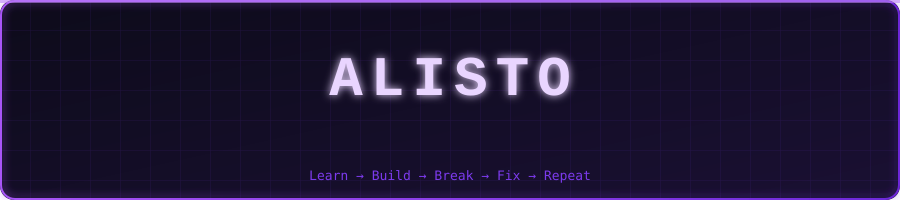

<div align="center">



</div>

## `whoami`

```text
Name       : Alisto
Focus      : Computer Science & Mathematics
Main tool  : Python
Mindset    : Learn → Build → Break → Fix → Repeat
Philosophy : Understanding matters more than memorising.
```

I'm a Computer Science and Mathematics student exploring the connection between logical thinking, mathematical ideas, and software development.

I'm learning by doing: experimenting, solving problems, and turning what I learn into practical projects.

## `~/tools-and-tech`

<div align="center">


</div>

**Primary language: Python.** I've also worked with Java, but Python is the language I use most.

## `~/github-stats`

<div align="center">


</div>

## `~/contribution-activity`

<div align="center">

<picture>
  <source media="(prefers-color-scheme: dark)" srcset="https://raw.githubusercontent.com/alisto05/alisto05/output/github-contribution-grid-snake-dark.svg"/>
  
</picture>

</div>

## `~/current-mission`

- Strengthening my programming and problem-solving skills.
- Exploring algorithms, data structures, and software engineering.
- Connecting mathematical theory with practical computing.
- Building projects that challenge what I know.

<div align="center">



</div>
